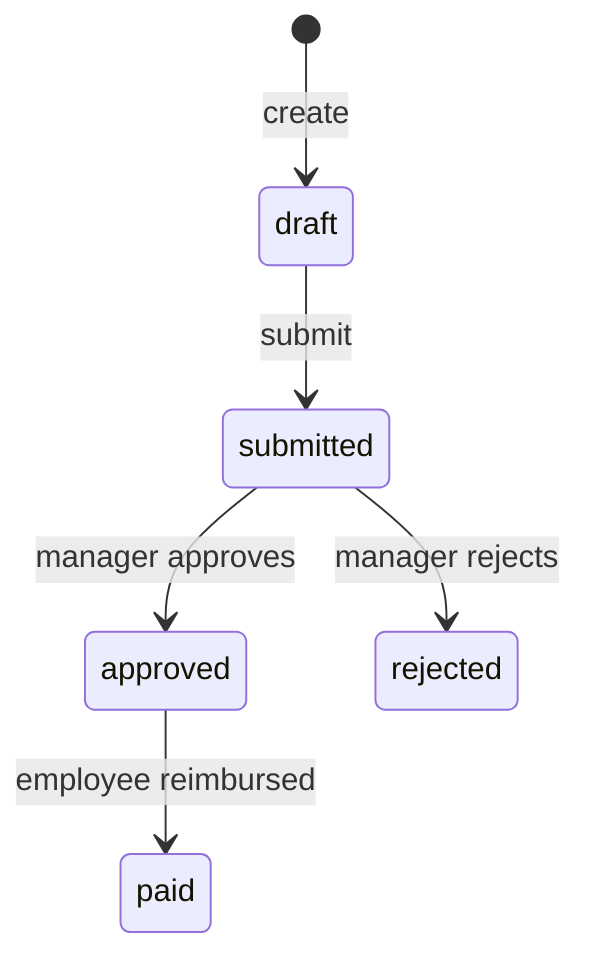

# Concepts

This topic explains how the parts of the Fjord Expense API work together, and why
they behave as they do. For more details see the individual guides, starting
with [Managing expenses](guides/expenses.md).

## The main objects

Everything in the API relates to an expense.

| Object | What it represents | How it relates to other objects |
| --- | --- | --- |
| Expense | One cost that an employee has paid for work, such as a hotel night or a train ticket. | Belongs to one employee and one category. Needs at least one receipt before it can be submitted. |
| Receipt | The evidence for an expense: a JPEG, PNG, or PDF file of up to 10 MB. | Attached to one expense. An expense can have several receipts. |
| Category | The type of cost, such as travel or meals. | Each expense has one category. Categories are read-only. |
| Approval | A manager's decision on a submitted expense. | Created when an expense is submitted. Each approval has one approver. |
| Invoice | A bill to a client for approved expenses. | Contains one or more approved expenses for one client, all in the same currency. |
| Report | A summary of approved expenses, with a title, a total amount, and a currency, that you can download as a PDF. It doesn't change after it's generated. | Generated from one or more approved expenses. Belongs to one employee. |
| Webhook | A subscription that notifies your system when something changes. | Sends events when expenses and invoices change. |

## Expense lifecyle

An expense moves through a fixed set of statuses. Each change goes one way and an
expense never returns to an earlier status.

| Status | Meaning | What you can do |
| --- | --- | --- |
| `draft` | The employee is still preparing the expense. | Edit it, delete it, add or remove receipts, and submit it. |
| `submitted` | The expense is waiting for a manager's decision. | Nothing. The expense is locked. |
| `approved` | A manager has accepted the expense. | Include it on an invoice. The employee can be reimbursed. |
| `rejected` | A manager has declined the expense and given a reason. | Nothing. Create a new expense with the corrections. |
| `paid` | The employee has been reimbursed. | Include it on an invoice, if it isn't on one already. |

An expense locks when it's submitted, and you can't edit or delete it, or remove its
receipts. This means the manager decides on exactly what the employee submitted,
and everything that follows, such as reimbursement or an invoice, matches that
decision.

Fjord Expense sets the `paid` status when the employee is reimbursed through
payroll, outside the API. No endpoint changes an expense to `paid`.

## Approvals: one decision per submission

When an employee submits an expense, the API creates an approval with the status
`pending` and assigns it to a manager. The manager either approves or rejects
it. The decision is final: an approval that is `approved` or `rejected` can't
change.

Two roles are involved:

- **Employees** create expenses, attach receipts, and submit expenses for
  approval. They can't use the approval endpoints.
- **Managers** see the approvals assigned to them and decide on each one.

A rejection must include a reason of up to 500 characters, which the employee
can see. A rejected expense can't be submitted again, so the employee makes
corrections by creating a new expense. Because only draft expenses can be
deleted, the rejected expense and its reason stay on record next to the new one.

For the steps, see [Approval workflows](guides/approvals.md).

## What happens to an approved expense

An approved expense can be used in two ways:

- **Reimbursement:** the employee is paid back for the cost, and the expense
  status changes to `paid`.
- **Invoicing:** if a client should pay for the cost, you include the expense on
  an invoice to that client.

Invoicing doesn't change an expense's status: the status tracks the employee's
side, from approval to reimbursement. So an expense can be both reimbursed and
invoiced, as when a client pays for an employee's travel. You can add an expense
to an invoice when its status is `approved` or `paid`.

An expense can appear on only one invoice, so a client is never billed twice for
the same cost. The invoice total is the sum of its expense amounts, so all
expenses on an invoice must use the same currency.

## Invoices

An invoice has its own statuses:

| Status | Meaning |
| --- | --- |
| `draft` | The invoice has been created but not sent. |
| `sent` | The invoice has been sent to the client. |
| `overdue` | The due date has passed and the invoice is still unpaid. The API sets this status automatically. |
| `paid` | The client has paid the invoice. |
| `cancelled` | The invoice has been cancelled. |

A request that would make an invalid change, such as sending an invoice that's
already been sent, returns `409 Conflict`. For the steps, see
[Generating invoices](guides/invoicing.md).

Fjord Expense sets the `paid` status when the client's payment is recorded in
the accounting system, and the `cancelled` status when an invoice is cancelled
there. Both happen outside the API, so no endpoint changes these statuses. To
find out when an invoice is paid, listen for the `invoice.paid` webhook event.

## Amounts and currencies

Amounts are strings with up to two decimal places, such as `"450.00"`, and each
expense has an ISO 4217 currency code, such as `NOK` or `EUR`.

The API uses strings because many decimal amounts, such as 0.10, can't be stored
exactly as binary floating-point numbers. The small rounding errors add up in
totals. A string keeps the exact amount until your code decides how to handle
it.

## Events and webhooks

Instead of checking the API for changes, you can register a webhook. The API
then sends an event to your endpoint when one of these things happens:

- An expense is created, submitted, approved, or rejected: `expense.created`,
  `expense.submitted`, `expense.approved`, `expense.rejected`.
- An invoice is created, sent, or paid: `invoice.created`, `invoice.sent`,
  `invoice.paid`.

Three details of how events are delivered affect how you handle them:

- **Retries:** if your endpoint doesn't respond with `200 OK` within 5 seconds,
  the API tries again after 1, 5, and 15 minutes. After three failed attempts,
  it disables the webhook.
- **Order:** because of retries, events can arrive out of order. Treat an event
  as a signal that something changed, and get the current state from the API.
- **Duplicates:** the same event can arrive more than once, so make your handling
  safe to repeat.

The API doesn't send an authentication header with events. To check that a
request comes from Fjord Expense, include a secret token in your endpoint's URL
path. For details, see [Webhooks](webhooks.md).

## Sandbox and production

The API has two environments with separate base URLs: a sandbox for testing and
production for real data. Every request is authenticated with an API key in the
`X-API-Key` header. For details, see [Authentication](getting-started/authentication.md).
